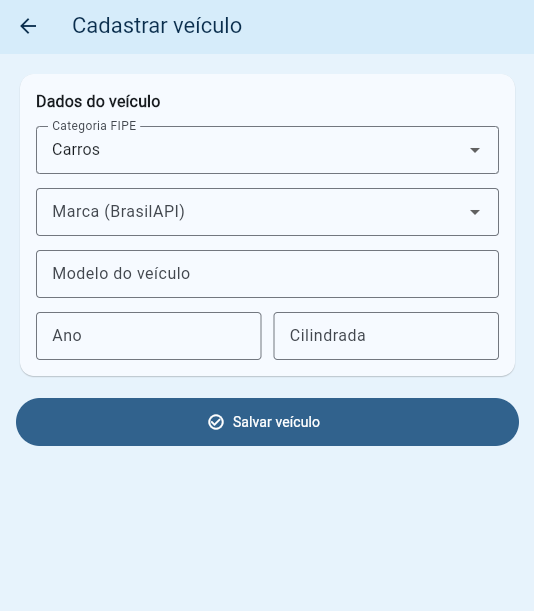
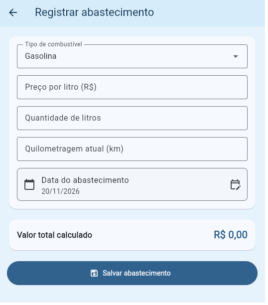
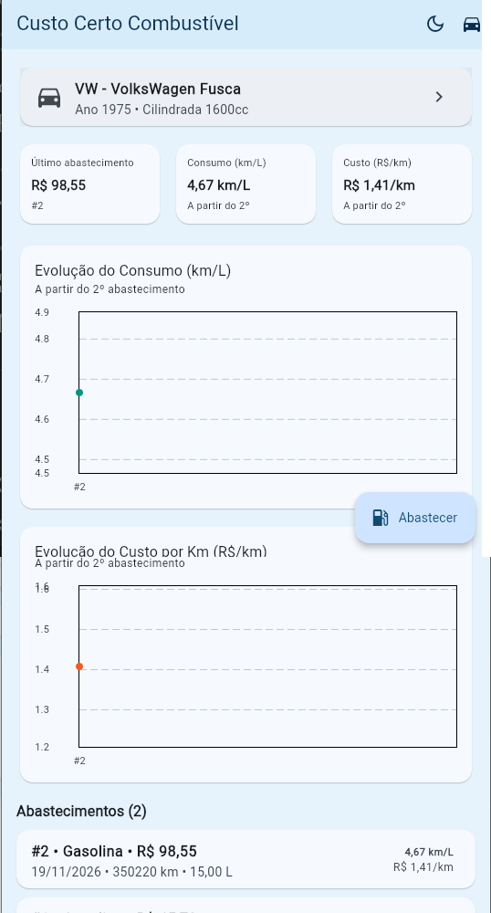
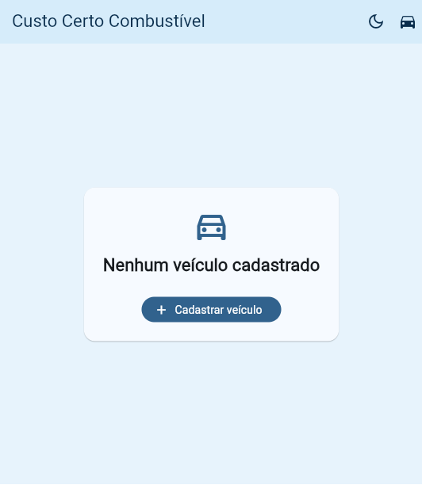
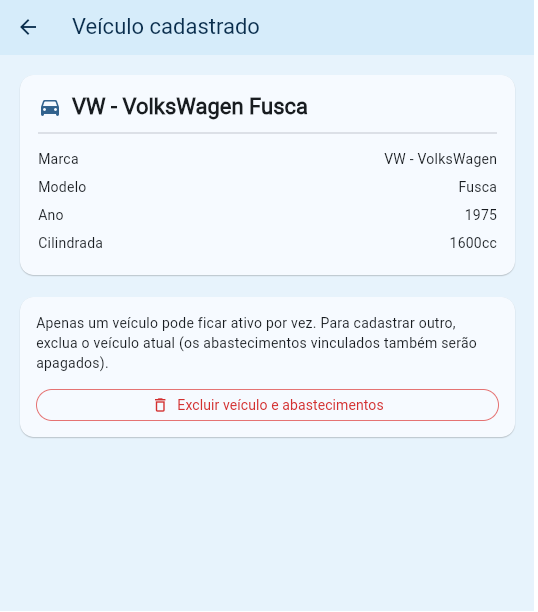
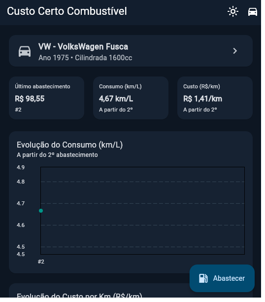

# Custo Certo Combustível

Aplicativo desenvolvido em **Flutter** para controle de gastos com combustível e acompanhamento da eficiência de consumo ao longo do tempo, referente à **Atividade Substitutiva da Prova 1** da disciplina de **Programação para Dispositivos Móveis II** (Fatec — Prof. Arley).

---

## 📱 Download do Aplicativo (Android)

* 📦 **[Baixar APK para Android (v1.0.0)](https://github.com/marcknero/custo_certo_combustivel/releases/tag/v1.0.0)** 

---

## 📋 Descrição e Funcionalidades

O **Custo Certo Combustível** permite gerenciar os abastecimentos de um veículo cadastrado e acompanhar indicadores financeiros e de desempenho:

* **Cadastro de veículo único:**
  * Consulta dinâmica de **marcas** e **modelos** (filtrados pela marca selecionada) utilizando a **BrasilAPI (Tabela FIPE)**.
  * Registro de **ano** e **cilindrada do motor**.
  * Exclusão do veículo atual mediante caixa de confirmação, removendo também todos os abastecimentos associados para permitir o cadastro de um novo veículo.
* **Registro de abastecimentos:**
  * Seleção do tipo de combustível (**Etanol**, **Gasolina** ou **Diesel**).
  * Registro de **preço por litro (R$)**, **quilometragem atual (km)**, **quantidade de litros** e **data** do abastecimento.
  * Cálculo automático do **valor total** do abastecimento ($\text{preço por litro} \times \text{litros}$).
* **Dashboard e indicadores de consumo:**
  * Exibição do valor de cada abastecimento registrado.
  * Cálculo automático a partir do **2º abastecimento** (considerando tanque completo):
    * **Distância percorrida:** $\text{km}_{\text{atual}} - \text{km}_{\text{anterior}}$
    * **Consumo médio ($km/L$):** $\frac{\text{distância percorrida}}{\text{litros atuais}}$
    * **Custo por quilômetro ($R\$/km$):** $\frac{\text{valor total atual}}{\text{distância percorrida}}$
  * Gráficos interativos de linha apresentando a evolução do consumo ($km/L$) e do custo por quilômetro ($R\$/km$) ao longo dos abastecimentos.
* **Persistência local e personalização:**
  * Armazenamento local no dispositivo para manter o veículo, os abastecimentos e a preferência de tema salvos após fechar e reabrir o aplicativo.
  * Alternância entre tema claro (azul claro) e modo noturno.

---

## 🚀 Instruções para Executar o Projeto

### Pré-requisitos
* [Flutter SDK](https://docs.flutter.dev/get-started/install) instalado e configurado no `PATH`.
* Navegador (Chrome/Edge) ou emulador/dispositivo Android conectado.

### Passo a passo

1. **Clone o repositório:**
   ```bash
   git clone https://github.com/seu-usuario/custo_certo_combustivel.git
   cd custo_certo_combustivel
   ```

2. **Instale as dependências:**
   ```bash
   flutter pub get
   ```

3. **Execute o aplicativo:**
   * **Na Web (Chrome):**
     ```bash
     flutter run -d chrome
     ```
   * **No Android:**
     ```bash
     flutter run
     ```

---

## 🌐 API e Bibliotecas Adotadas

### API Pública
* **[BrasilAPI (FIPE)](https://brasilapi.com.br/docs#tag/FIPE):** utilizada para consultar as marcas de veículos (`GET /api/fipe/marcas/v1/{tipoVeiculo}`) e listar os modelos correspondentes à marca escolhida (`GET /api/fipe/veiculos/v1/{tipoVeiculo}/{codigoMarca}`).

### Bibliotecas Flutter (`pubspec.yaml`)
* **[`http`](https://pub.dev/packages/http):** realização das requisições REST para consulta de marcas e modelos na BrasilAPI.
* **[`shared_preferences`](https://pub.dev/packages/shared_preferences):** persistência local dos dados do veículo, histórico de abastecimentos e preferência de tema.
* **[`fl_chart`](https://pub.dev/packages/fl_chart):** renderização dos gráficos de linha de evolução de consumo ($km/L$) e custo por quilômetro ($R\$/km$).
* **[`intl`](https://pub.dev/packages/intl):** formatação de valores monetários (`R$`), números decimais e datas no padrão brasileiro (`pt_BR`).

---

## 🗂️ Estrutura do Projeto

```text
lib/
├── main.dart                         # Ponto de entrada, configuração de temas e inicialização
├── models/
│   ├── vehicle.dart                  # Modelo de dados do veículo
│   └── fueling.dart                  # Modelo de dados dos abastecimentos e cálculo do total
├── services/
│   ├── brasil_api_service.dart       # Integração HTTP com a BrasilAPI (marcas e modelos)
│   └── local_storage_service.dart    # Persistência local via SharedPreferences
├── utils/
│   └── fuel_metrics.dart             # Regras de cálculo de distância, km/L e R$/km
├── screens/
│   ├── home_screen.dart              # Dashboard principal, indicadores e histórico
│   ├── vehicle_screen.dart           # Cadastro e exclusão com confirmação do veículo
│   └── fueling_form_screen.dart      # Formulário de registro de abastecimentos
└── widgets/
    └── fuel_charts.dart              # Gráficos de evolução de km/L e R$/km
```

---

## 📸 Capturas de Tela

| Cadastro de Veículo (BrasilAPI) | Registro de Abastecimento |
| :---: | :---: |
|  |  |

| Dashboard e Indicadores | Pagina Inicial (sem veículo cadastrado) |
| :---: | :---: |
|  |  |

| Exclusão | Confirmação da Exclusão |
| :---: | :---: |
|  |  |

| Modo Noturno |
| :---: |
| 